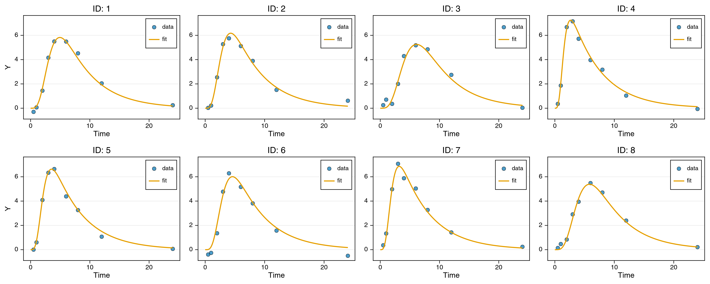
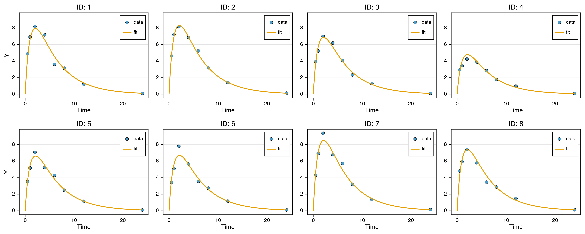

# Vector-Valued ODE States (Laplace)

An ODE state can be a vector: when its `@initialDE` value is a vector, the state is a
vector inside `@DifferentialEquation`, and `x(t)` returns the vector in `@formulas` (see
[Vector-Valued States](../model-building/differential-equation.md#Vector-Valued-States)).
This tutorial uses that in two models on small simulated datasets: a chain of transit
compartments whose length is a constant, and a latent neural ODE whose state dimension is
a constant. Both are fitted with `Laplace` using few iterations, so the results shown are
illustrative.

## What You Will Learn

- Declare a vector state through its initial value and write its derivative element-wise
  (`D(x[1]) ~ ...`, `D(x[2:end]) ~ ...`).
- Dose into a compartment by name (`CMT = "depot"`, or an element such as `"transit[1]"`).
- Change the number of compartments or the latent dimension by changing one constant.
- Write a latent neural ODE with one line, `D(x) ~ s * NN(x ./ 100.0, z_nn)`.

## Part 1: Transit Compartments

### The model

A dose enters `depot`, passes through `NTR` transit compartments, and reaches `central`,
from which it is eliminated. `transit` is a vector state of length `NTR` because its
initial value is `zeros(NTR)`. Its first element receives from `depot`; elements `2` to
`NTR` each receive from their predecessor, written as one broadcast line over the range
`2:end`.

```julia
using NoLimits
using CairoMakie, AlgebraOfGraphics
using DataFrames
using Distributions
using Random

const NTR = 4   # number of transit compartments

model = @Model begin
    @fixedEffects begin
        ktr = RealNumber(1.5, scale = :log)
        ke = RealNumber(0.2, scale = :log)
        V = RealNumber(10.0, scale = :log)
        ω = RealNumber(0.3, scale = :log)
        σ = RealNumber(0.3, scale = :log)
    end
    @covariates begin
        t = Covariate()
    end
    @randomEffects begin
        η = RandomEffect(Normal(0.0, ω); column = :ID)
    end
    @preDifferentialEquation begin
        ktr_i = ktr * exp(η)
    end
    @DifferentialEquation begin
        D(depot) ~ -ktr_i * depot
        D(transit[1]) ~ ktr_i * (depot - transit[1])
        D(transit[2:end]) ~ ktr_i .* (transit[1:(end - 1)] .- transit[2:end])
        D(central) ~ ktr_i * transit[end] - ke * central
    end
    @initialDE begin
        depot = 0.0
        transit = zeros(NTR)
        central = 0.0
    end
    @formulas begin
        y ~ Normal(central(t) / V, σ)
    end
end
```

Each element of `transit` is given exactly once: `transit[1]` by the first line and
`transit[2]` to `transit[NTR]` by the range `2:end`. Because the range is written relative
to `end`, the block does not depend on the value of `NTR`. The broadcast right-hand side is
written into the derivative in place, without temporary vectors.

### Data with dosing by compartment name

Eight subjects receive a bolus of 100 into `depot` at time zero. `CMT` names the
compartment. In a model with a vector state, `CMT` must be a name (`"depot"`, `"central"`,
or an element such as `"transit[2]"`); an integer `CMT` is rejected, because the position
of a compartment in the state vector depends on `NTR`. The observations `y` are simulated
from the model at its initial parameter values.

```julia
obs_t = [0.5, 1.0, 2.0, 3.0, 4.0, 6.0, 8.0, 12.0, 24.0]
df = DataFrame(
    ID = Int[], t = Float64[], EVID = Int[], AMT = Float64[], RATE = Float64[],
    CMT = String[], y = Union{Missing, Float64}[]
)
for id in 1:8
    push!(df, (id, 0.0, 1, 100.0, 0.0, "depot", missing))
    for tt in obs_t
        push!(df, (id, tt, 0, 0.0, 0.0, "depot", 0.0))
    end
end

dm_kw = (
    primary_id = :ID, time_col = :t, evid_col = :EVID, amt_col = :AMT,
    rate_col = :RATE, cmt_col = :CMT,
)
df.y = simulate_data(DataModel(model, df; dm_kw...); rng = Random.Xoshiro(1)).y
first(df, 6)
```

<!- injected:vs1-transit-df ->
```text
6×7 DataFrame
 Row │ ID     t        EVID   AMT      RATE     CMT     y
     │ Int64  Float64  Int64  Float64  Float64  String  Float64?
─────┼──────────────────────────────────────────────────────────────────
   1 │     1      0.0      1    100.0      0.0  depot   missing
   2 │     1      0.5      0      0.0      0.0  depot        -0.303299
   3 │     1      1.0      0      0.0      0.0  depot         0.0659873
   4 │     1      2.0      0      0.0      0.0  depot         1.44196
   5 │     1      3.0      0      0.0      0.0  depot         4.15758
   6 │     1      4.0      0      0.0      0.0  depot         5.49227
```

`summarize` lists the states and the compartment names available for `CMT` (excerpt):

```julia
dm = DataModel(model, df; dm_kw...)
summarize(dm)
```

<!- injected:vs1-transit-states ->
```text
ODE states
  states            : depot, transit[1:4], central
  flat elements (6) : depot, transit[1], transit[2], transit[3], transit[4], central
```

### Fit

```julia
res = fit_model(dm, NoLimits.Laplace(; optim_kwargs = (maxiters = 50,)); rng = Random.Xoshiro(2))
NoLimits.get_params(res; scale = :untransformed)
```

<!- injected:vs1-transit-params ->
```text
ComponentVector{Float64}(ktr = 1.8056881538706897, ke = 0.19418178539688755, V = 10.139912052849871, ω = 0.3383084011460152, σ = 0.3069612949436432)
```

```julia
plot_fits(res; ncols = 4, shared_x_axis = true, shared_y_axis = true)
```

<!- injected:vs1-transit-pfit ->


### Changing the number of compartments

The chain length is set only by the constant. Running the same code with
`const NTR = 2` or `const NTR = 8` (and nothing else changed) fits chains of two or eight
transit compartments to the same data. The table lists the final objective of each fit
(50 Laplace iterations; the data were simulated with `NTR = 4`).

<!- injected:vs1-transit-objectives ->
```text
3×2 DataFrame
 Row │ NTR    objective
     │ Int64  Float64
─────┼──────────────────
   1 │     2    60.2331
   2 │     4    35.8924
   3 │     8    44.9667
```

## Part 2: A Latent Neural ODE

### Data

The data are concentrations of a one-compartment model with first-order absorption,
computed in closed form for eight subjects with a subject-specific volume and
multiplicative noise.

```julia
dose, ka, ke, V = 100.0, 1.0, 0.2, 10.0
t_obs = [0.5, 1.0, 2.0, 4.0, 6.0, 8.0, 12.0, 24.0]
rng = Random.Xoshiro(3)
df_nn = DataFrame(ID = Int[], t = Float64[], y = Float64[])
for id in 1:8
    Vi = V * exp(0.2 * randn(rng))
    for tt in t_obs
        c = dose * ka / (Vi * (ka - ke)) * (exp(-ke * tt) - exp(-ka * tt))
        push!(df_nn, (id, tt, c * exp(0.1 * randn(rng))))
    end
end
first(df_nn, 6)
```

<!- injected:vs1-nn-df ->
```text
6×3 DataFrame
 Row │ ID     t        y
     │ Int64  Float64  Float64
─────┼─────────────────────────
   1 │     1      0.5  4.88012
   2 │     1      1.0  6.91439
   3 │     1      2.0  8.17302
   4 │     1      4.0  7.17147
   5 │     1      6.0  3.62082
   6 │     1      8.0  3.15074
```

### The model

The latent state `x` has dimension `NSTATE` and is measured in units of the dose. Its
derivative is a feed-forward network of the state, scaled by a subject-specific factor `s`,
minus a first-order loss `kel .* x`; one line describes all components. The last component,
multiplied by the dose and divided by a subject-specific volume, is the predicted
concentration.

```julia
const NSTATE = 2   # latent state dimension

model_nn = @Model begin
    @fixedEffects begin
        tvv = RealNumber(10.0, scale = :log)
        omega_v = RealNumber(0.2, scale = :log)
        omega_s = RealNumber(0.2, scale = :log)
        sigma = RealNumber(0.1, scale = :log)
        z_nn = FFNNParameters(
            (NSTATE, 8, NSTATE); activation = :tanh,
            output_activation = :identity, function_name = :NN, calculate_se = false
        )
        kel = RealNumber(0.1, scale = :log)
    end
    @covariates begin
        t = Covariate()
    end
    @randomEffects begin
        eta_v = RandomEffect(Normal(0.0, omega_v); column = :ID)
        eta_s = RandomEffect(Normal(0.0, omega_s); column = :ID)
    end
    @preDifferentialEquation begin
        vc = tvv * exp(eta_v)
        s = exp(eta_s)
    end
    @DifferentialEquation begin
        D(x) ~ s .* NN(x, z_nn) .- kel .* x
    end
    @initialDE begin
        x = vcat(1.0, zeros(NSTATE - 1))
    end
    @formulas begin
        cp = 100.0 * x(t)[NSTATE] / vc
        y ~ Normal(cp, abs(cp) * sigma + 0.05)
    end
end
```

Two details keep the likelihood finite. The first component starts at `1.0` (the dose)
rather than at zero: with all components at zero and the network biases at their initial
value of zero, the right-hand side is zero, the state stays at zero, and the predicted
concentration is zero at all times. The constant `0.05` in the standard deviation is a
floor, so that a predicted concentration of zero does not give a standard deviation of zero.

To use a larger latent space, change `NSTATE`: the network input and output sizes, the
initial value and the observed component follow from it.

### Fit

```julia
dm_nn = DataModel(model_nn, df_nn; primary_id = :ID, time_col = :t)
res_nn = fit_model(dm_nn, NoLimits.Laplace(; optim_kwargs = (maxiters = 300,)); rng = Random.Xoshiro(4))
(objective = NoLimits.get_objective(res_nn),)
```

<!- injected:vs1-nn-obj ->
```text
(objective = 20.96513733989882,)
```

```julia
plot_fits(res_nn; ncols = 4, shared_x_axis = true, shared_y_axis = true)
```

<!- injected:vs1-nn-pfit ->


## Notes

- **Iteration counts are small.** Both fits stop after a fixed, small number of
  iterations so that the example runs quickly; the estimates are illustrative.
- **Latent-model choices.** Measuring the state in units of the dose keeps the network
  inputs and outputs of order one, and the loss term `kel .* x` gives the state a decay
  that the network alone has to learn otherwise. In trials for this page, the same model
  without these two choices did not follow the data within a few hundred iterations.
- **Element-wise or whole-vector form.** `D(transit) ~ ktr_i .* (vcat(depot, transit[1:(end - 1)]) .- transit)`
  describes the same chain in one line and gives the same results; the element-wise form
  avoids the temporary vector created by `vcat`.
- **Closed-form solutions** are used only for systems of scalar states, so models with a
  vector state are solved numerically.

## Where to go next

- [Vector-Valued States](../model-building/differential-equation.md#Vector-Valued-States) -
  the rules for vector states and element-wise derivatives.
- [Data Model Construction](../data-model-construction.md) - event tables and `CMT`.
- [Neural Differential Equations (SAEM)](mixed-effects-nn-saem.md) - networks inside a
  compartmental ODE.
- [All tutorials](index.md) - the full list, tagged by outcome, model, and estimator.
